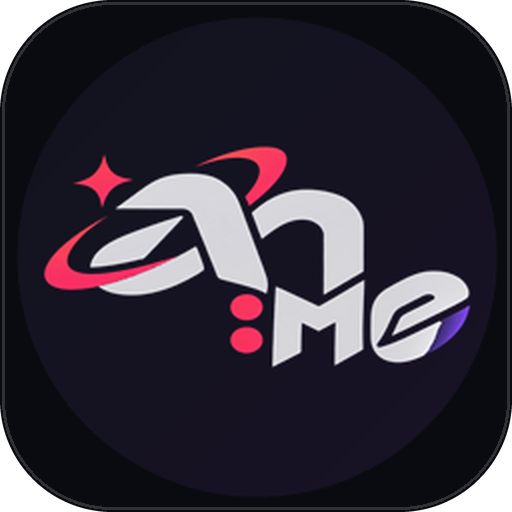
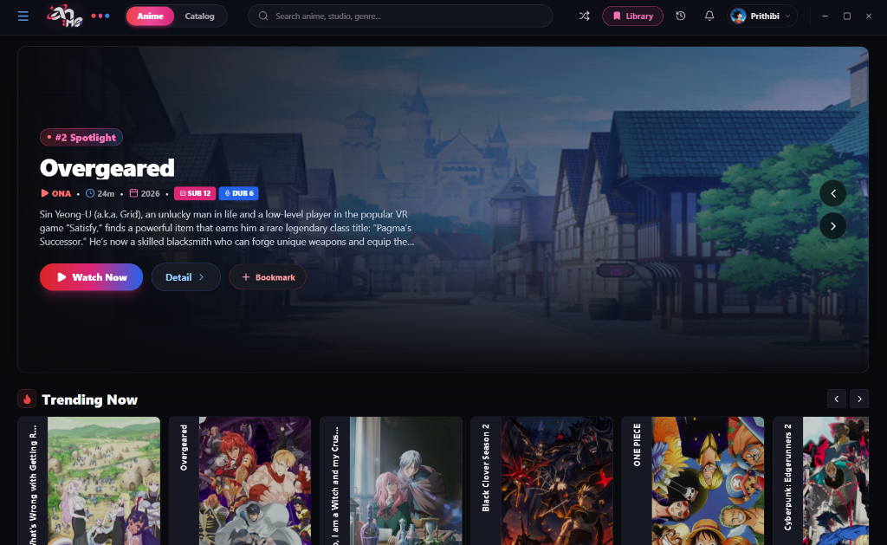
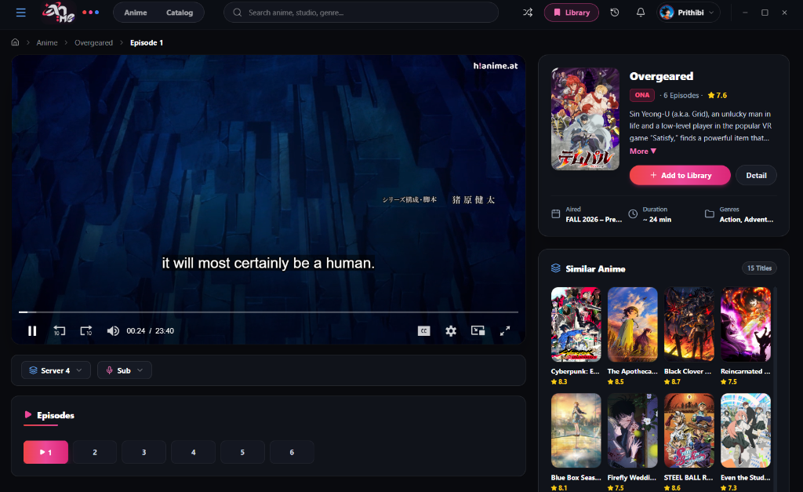

# <p align="center"><br>An:me Desktop</p>

<p align="center">
  <strong>A fast, lightweight, and modern desktop anime discovery & streaming client.</strong>
</p>

<p align="center">
  <a href="https://github.com/Prithibi17/An-me/releases/latest"></a>
  
  
  
  
  
  
</p>

---

## 📖 Overview

**An:me Desktop** is an ultra-fast, aesthetically tuned anime exploration and streaming application engineered for the desktop. Built with **Electron**, **React 19**, and **Tailwind CSS**, it pairs a seamless frameless dark UI with instant episode loading, robust metadata discovery via the AniList GraphQL API, smart English title heuristics, offline-first watch status tracking, and multiplatform desktop support.

---

## 📸 App Screenshots

<p align="center">
  <strong>Home & Spotlight Discovery</strong>
</p>
<p align="center">
  
</p>

<br>

<p align="center">
  <strong>Desktop Video Player & Stream View</strong>
</p>
<p align="center">
  
</p>

---

## ✨ Features

### 🖥️ Native Multiplatform Desktop Experience
- **Cross-Platform**: Officially packaged for **Windows (x64)**, **macOS (Apple Silicon & Intel)**, and **Linux (x64)**.
- **Windows Setup Wizard (`An-me-Setup.exe`)**: Single standalone setup installer that guides users through folder selection, creates Desktop and Start Menu shortcuts, and registers with Windows Installed Apps for clean uninstallation.
- **Frameless Dark Window**: Custom sleek titlebar with smooth window dragging, minimize, maximize, and exit controls.
- **Instant Launch & ASAR Packaging**: High-performance ASAR archive distribution with sub-second startup times and zero file-scanning latency.
- **Polished Cyberpunk Splash Screen**: Clean, single-layer neon aura and animated cards with smooth transitions into the main app.

### 🎬 Anime Discovery (AniList GraphQL Engine)
- **Authoritative English Titles**: Intelligent linguistic heuristic engine (`titleHelper.ts`) that scores and prioritizes official English titles over Japanese Romaji transliterations and automatically filters out non-Latin scripts (Kanji, Kana, Thai).
- **Accurate Episode Capping**: Strictly displays released episodes for ongoing broadcast series (e.g., 4 subbed / 3 dubbed) instead of displaying phantom future episode slots.
- **Spotlight Hero Carousel**: Wide-screen backdrop carousel showcasing top trending and spotlight anime with quick-play triggers.
- **Leaderboards & Top 10**: Filterable rankings across **Today**, **This Week**, and **This Month**.
- **Interactive Airing Schedule**: Day-by-day broadcast calendar (Sunday to Saturday) with air times and episode counts.
- **Deep Search & Filters**: Fuzzy search with autocomplete dropdown and multi-criteria filters (Genre, Season, Year, Sort).
- **Character & Relations Roster**: Full character rosters with voice actors and related franchise series.

### ⚡ Streaming & Video Player
- **Default Server 4**: All titles default to high-performance Server 4 upon launch with stable playback.
- **Multi-Server Streaming**: Select and switch across available stream sources on demand.
- **Audio Track Selection**: One-click toggle between **SUB** (Original with subtitles) and **DUB** (English dubbed).
- **Episode Quick Jumper & Number Input**: Jump to any episode or type your desired episode number directly to navigate instantly.

### 👁️ Offline Watch Progress & Viewing History
- **3-Tier Visual Indicators**:
  - 🟦 **Watched**: Watched episodes are dimmed with a soft, transparent cyan-blue tint without distracting timer counters.
  - 🎨 **Currently Watching**: Active playback episode is highlighted with an energetic **blue-to-pink** gradient border and glow.
  - ⬛ **Yet to Watch**: Clean, standard appearance for unwatched episodes.
- **Resume Playback**: Remembers your exact playback position and last watched episode locally on device.
- **100% Offline Persistence**: Uses local storage microservices without requiring cloud logins or exposing viewing habits.

---

## 📥 Downloads & Releases

Download pre-built desktop packages from the [**GitHub Releases**](https://github.com/Prithibi17/An-me/releases/latest) page:

| Operating System | Package | Type | Format |
| :--- | :--- | :--- | :--- |
| **Windows 10 / 11 (x64)** | [**`An-me-Setup.exe`**](https://github.com/Prithibi17/An-me/releases/latest) | **Direct Setup Installer** | Single `.exe` (No zip needed) |
| **Windows 10 / 11 (x64)** | `An-me-Windows-Portable-x64.zip` | Standalone Portable | `.zip` archive |
| **macOS Apple Silicon** | `An-me-macOS-arm64.zip` | Native App Bundle (M1-M4) | `.zip` (.app) |
| **macOS Intel** | `An-me-macOS-x64.zip` | Native App Bundle (x64) | `.zip` (.app) |
| **Linux (x64)** | `An-me-Linux-x64.zip` | Standalone Bundle | `.zip` archive |

---

## 🛠️ Installation Guide

### Windows
- **Single-File Installer**: Download **`An-me-Setup.exe`**, double-click, and follow the setup wizard.
- **Portable Version**: Download and extract `An-me-Windows-Portable-x64.zip`, then double-click `An-me.exe`.

### macOS
1. Download `An-me-macOS-arm64.zip` (for Apple Silicon) or `An-me-macOS-x64.zip` (for Intel).
2. Extract the zip archive to reveal `An-me.app`.
3. Drag `An-me.app` into your `/Applications` folder and double-click to launch.

### Linux
1. Download and extract `An-me-Linux-x64.zip`.
2. Open terminal in the extracted folder and run:
   ```bash
   chmod +x An-me
   ./An-me
   ```

---

## 🚀 Building from Source

### 1. Prerequisites
- [Node.js](https://nodejs.org/) (v18.0.0 or higher)
- [Git](https://git-scm.com/)

### 2. Clone & Install
```bash
git clone https://github.com/Prithibi17/An-me.git
cd An-me
npm install
```

### 3. Configure Streaming Providers
For copyright and security protection, raw video streaming provider endpoints are omitted from public commits. Before running, copy the example templates:
```bash
cp src/services/providers.example.ts src/services/providers.ts
cp src/services/availability.example.ts src/services/availability.ts
```
*(On Windows PowerShell: `Copy-Item src/services/providers.example.ts src/services/providers.ts`)*

### 4. Run Development Builds
```bash
# Run desktop Electron build (Vite build + Electron)
npm run desktop

# Or run Vite development server in web browser mode
npm run dev:web
```

### 5. Run Automated Tests
```bash
npm test
```
*Executes all 55 tests covering intelligent search, chronological feeds, title heuristics, and watch progress tracking.*

### 6. Package Desktop Installers
```bash
# Build Windows portable and setup installer
npm run dist

# Build Linux x64 package
npm run package:linux

# Build macOS packages (arm64 & x64)
npm run package:mac
```

---

## 📂 Project Architecture

```
an-me-desktop/
├── electron/
│   ├── main.cjs               # Electron main process (lifecycle, IPC handlers, uninstaller registry)
│   └── preload.cjs            # Secure contextBridge API (window controls, disk storage, installer bridge)
├── src/
│   ├── components/
│   │   ├── installer/         # Setup and Uninstall wizards
│   │   ├── watch/             # Video player & episode selector
│   │   ├── details/           # Anime detail overview, cast, and relations
│   │   ├── home/              # Spotlight, Continue Watching, trending strips
│   │   ├── notifications/     # Episode notification drawer
│   │   ├── profile/           # User profile and avatar picker
│   │   └── SplashScreen.tsx   # Cinematic branded splash loader
│   ├── services/
│   │   ├── anilist.ts         # AniList GraphQL queries & character/relation mapper
│   │   ├── titleHelper.ts     # Linguistic scoring engine for authentic English titles
│   │   ├── watchProgress.ts   # 3-tier viewing status and timestamp persistence
│   │   ├── latestEpisodes.ts  # Chronological episode aggregator & audio filters
│   │   ├── searchEngine.ts    # Intelligent fuzzy search & typo correction
│   │   ├── storage.ts         # Watchlist and preference state
│   │   └── localStore.ts      # Offline persistent disk storage client
│   ├── types/                 # TypeScript type definitions
│   ├── App.tsx                # Main application shell
│   └── main.tsx               # App entry & router
├── tests/                     # 55 automated unit & integration test suites
├── public/                    # High-res icons, splash art, and avatars
└── package.json
```

---

## 🔒 Security & Privacy

- **Zero Tracking**: No analytics, telemetry, or third-party tracking scripts.
- **Offline First**: Watchlists, episode progress, and local preferences are stored locally on your machine.
- **Provider Protection**: Streaming extraction endpoints and scrapers remain protected and untracked.

---

## 📜 License

This project is open source and available under the [MIT License](LICENSE).
